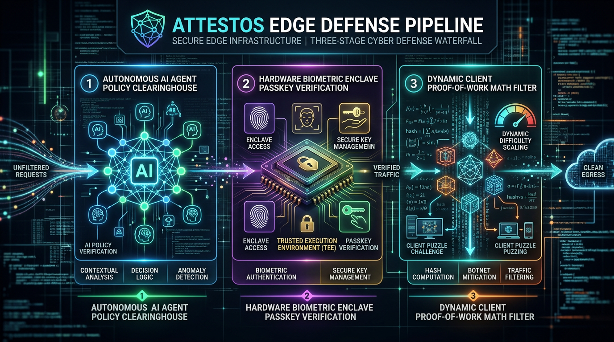
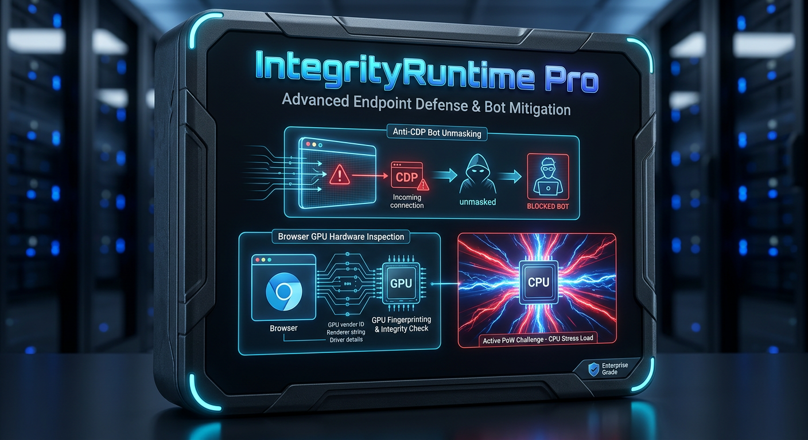
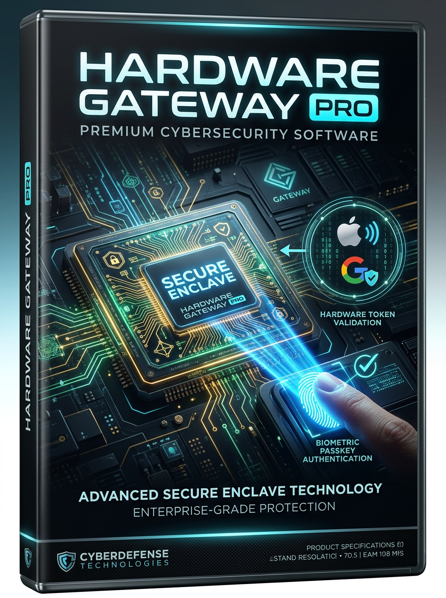
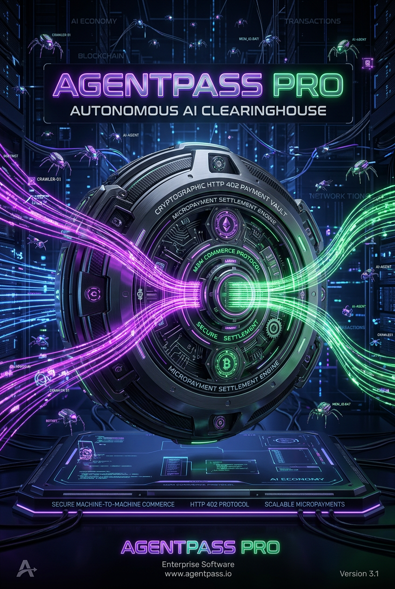
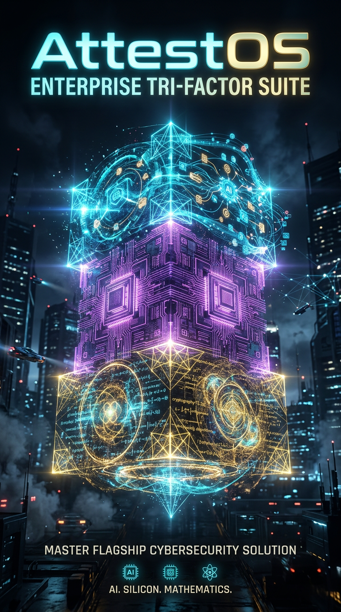

# AttestOS Developer Architecture & Product Reference Manual
**Document Version:** 2.1.0-prod  
**Target Audience:** Security Engineers, DevOps, Full-Stack Architects  
**Repository:** [`https://github.com/AttestOS/attestos`](https://github.com/AttestOS/attestos)

---

## 1. Technical Paradigm Shift

```
TRADITIONAL CAPTCHA PARADIGM (DEAD)         ATTESTOS CLIENT INTEGRITY (2026)
┌─────────────────────────────────┐         ┌─────────────────────────────────┐
│ • Distorted text & image grids  │         │ • Zero human visual puzzles     │
│ • YOLOv8 cracked with 100% acc  │  ====>  │ • Hardware Secure Enclave pass  │
│ • 12-18s user latency fatigue   │         │ • Stateless WebCrypto PoW tax   │
│ • $0.0008 / solve AI bypasses   │         │ • Programmatic HTTP 402 Paywall │
└─────────────────────────────────┘         └─────────────────────────────────┘
```

The arms race has definitively moved from computer vision to **client environment integrity and autonomous economic settlement**.



---

## 2. Product Catalog & Cover Artwork

AttestOS operates all three pivots simultaneously as distinct products and freebies:

### ⚡ Pivot A: Compute Integrity
| Tier | Deliverable | Description |
| :--- | :--- | :--- |
| **Freebie** | **Ghost-PoW Client** | Zero-dependency, client-side WebCrypto SHA-256 Proof-of-Work solver. Generates and solves mathematical challenges in ~80ms in background with zero human friction. |
| **Pro ($49/mo)** | **IntegrityRuntime Pro** | Deep Anti-CDP automation detection, Chrome DevTools Protocol unmasking, WebGL GPU vendor validation, mouse trajectory micro-entropy analyzer, and bot CPU multiplier escalation up to 4096x. |



---

### 🛡️ Pivot B: Hardware Enclave Gateway
| Tier | Deliverable | Description |
| :--- | :--- | :--- |
| **Freebie** | **AttestKit Free** | Silent W3C WebAuthn passkey assertion verifier. Admits legitimate users via Apple TouchID / Windows Hello hardware credentials in 0ms. Includes 25,000 free checks/month. |
| **Pro ($149/mo)** | **Hardware Gateway Pro** | Enterprise RFC 9505 Private Access Token (PAT) gateway. Validates Apple iOS 16+ / macOS Ventura+ blind signatures, Google Play Integrity attestations, and Secure Enclave cryptographic proofs. |



---

### 🤖 Pivot C: Agentic Gateway
| Tier | Deliverable | Description |
| :--- | :--- | :--- |
| **Freebie** | **Robots.ai Open Standard** | RFC-compliant standard located at `/.well-known/robots.ai`. Negotiates clean markdown content for verified search crawlers (Perplexity, Applebot, Google) while disallowing training bots. |
| **Pro ($99/mo)** | **AgentPass Pro** | Autonomous programmatic HTTP 402 Payment Required clearinghouse. Debits balance micro-charges ($0.002/req) from commercial AI agents with instant cryptographic settlement. |



---

### 🏰 Flagship: Enterprise Tri-Factor Suite
| Tier | Deliverable | Description |
| :--- | :--- | :--- |
| **Enterprise ($299/mo)** | **Enterprise Tri-Factor Suite** | Unifies all three pivots into an autonomous self-tuning defense waterfall with dedicated Cloudflare Edge routing, unlimited verifications, white-label portals, and 99.99% edge SLAs. |



---

## 3. The 2/10th Lean Quota Architecture

AttestOS is designed to operate on a strict **$0 budget** while respecting Cloudflare Worker free tier limits:

```
┌────────────────────────────────┬───────────────────┬───────────────────┐
│ Resource Metric                │ Cloudflare Free   │ AttestOS Edge     │
├────────────────────────────────┼───────────────────┼───────────────────┤
│ Worker CPU Execution Time      │ 10.0 ms / req     │ <0.03 ms / req    │
│ Cloudflare KV Storage Ops      │ Limited free      │ 0 KV Ops (100% WS)│
│ Repeat Verification Redundancy │ 100% evaluated    │ >90% fast-pass    │
│ Edge Cache TTL (CDN)           │ Dynamic           │ 24 Hours / 1 Week │
└────────────────────────────────┴───────────────────┴───────────────────┘
```

1. **Stateless WebCrypto HMAC Signatures:** Challenges and sessions are authenticated mathematically using `crypto.subtle` with zero database or KV reads.
2. **24-Hour Attested Fast-Pass Session Cookie (`attestos_session`):** Once a legitimate visitor is verified via passkey or PoW, an HMAC-signed session cookie grants instant 0ms access for 24 hours, eliminating redundant checks and conserving >90% of free quotas.

---

## 4. Edge API Endpoints Reference

### `GET /healthz`
Health status and runtime metrics.
* **Response:**
  ```json
  {
    "status": "healthy",
    "runtime": "cloudflare-worker-edge",
    "brand": "AttestOS",
    "version": "2.1.0-edge",
    "quotaOptimization": "2/10th-lean-mode"
  }
  ```

### `GET /api/pow/challenge`
Generates a stateless Proof-of-Work challenge with rotating HMAC salt.
* **Query Params:** `difficulty` (default: 4), `siteKey` (default: 'default')
* **Response:**
  ```json
  {
    "challengeId": "3f8b01a2...",
    "salt": "a1b2c3d4...",
    "difficulty": 4,
    "expiresAt": 1793026319000,
    "signature": "hmac_sha256_hex..."
  }
  ```

### `POST /api/pow/verify`
Verifies mathematical nonce solution.
* **Payload:** `{ salt, nonce, difficulty, timestamp, expiresAt, signature, siteKey }`
* **Response:** Returns `success: true` and issues the 24-hour `attestos_session` cookie.

### `POST /api/pipeline/evaluate`
Master Tri-Factor waterfall evaluator:
1. Evaluates User-Agent against Pivot C `robots.ai` policy.
2. Checks Pivot B Hardware Secure Enclave token.
3. Checks Pivot A Proof-of-Work solution or Anti-CDP telemetry.
4. Returns admission decision (`200 Admitted`, `428 Challenge Required`, or `403 Blocked`).

### `GET /api/agentpass/request`
Autonomous agent HTTP 402 clearinghouse endpoint.
* **Unauthenticated Request:** Returns HTTP 402 Payment Required with machine-readable quote:
  ```json
  {
    "error": "Autonomous Agent Programmatic Access Requires Paid Settlement",
    "quoteId": "quote_7e2a9b",
    "feePerRequest": 0.002,
    "currency": "USD",
    "whopCheckoutUrl": "https://whop.com/checkout/plan_agentpass_pro"
  }
  ```
* **Header `X-Agent-Key` or `Authorization: Bearer agent_...`:** Returns HTTP 200 with structured JSON data feed.
