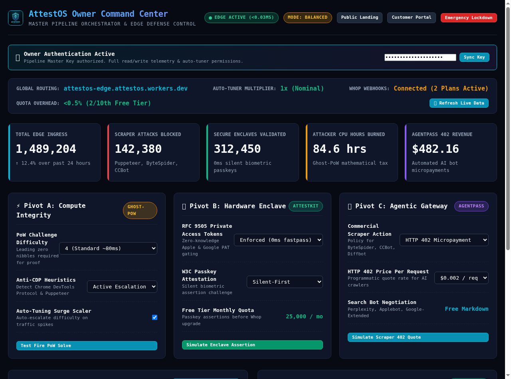

# AttestOS Owner Command Center & Pipeline Operations Manual
**Document Version:** 2.1.0-prod  
**Classification:** Internal Operator Guide  
**Live Access:** [`https://attestos-edge.attestos.workers.dev/console`](https://attestos-edge.attestos.workers.dev/console) (or `/admin`)

---

## 1. Executive Overview

The **AttestOS Owner Command Center** is the centralized control station for operating the entire Tri-Factor Edge Defense Pipeline. From this single interface, the system owner can inspect global network telemetry, adjust difficulty knobs across all three pivots in real time, manage tenant licenses, test-fire attack simulations, and engage emergency lockdown protocols across Cloudflare's edge network.



---

## 2. Authentication & Security Access

1. Navigate to [`https://attestos-edge.attestos.workers.dev/console`](https://attestos-edge.attestos.workers.dev/console).
2. The **Master Authentication Banner** at the top verifies your owner authority:
   - Default Master Key: `attestos_master_2026` (configured via environment or local `.env`).
   - Enter your key in the password input and click **Sync Key**.
   - Your authorization is cached in browser `sessionStorage` and transmitted via the `X-Owner-Key` header for privileged operations.

---

## 3. Real-Time Telemetry & The Dopamine Ticker

The Command Center provides a high-visibility KPI grid tracking live defensive metrics:

| Metric Card | Description | Value Benchmark |
| :--- | :--- | :--- |
| **Total Edge Ingress** | Cumulative HTTP requests evaluated at Cloudflare edge | Standard volume |
| **Scrapers Blocked** | Automated headless scrapers, Puppeteer, and unauthorized bots dropped | Instant mitigation |
| **Secure Enclaves Validated** | Legitimate human users admitted via 0ms hardware biometrics | 0 friction passes |
| **Attacker CPU Hours Burned** | Total CPU time consumed on attacker clusters via Ghost-PoW | Asymmetric economic cost |
| **AgentPass 402 Revenue** | Real-time dollar balance collected from commercial AI crawlers | Payout treasury |

The command strip also monitors **Quota Overhead**, confirming the edge engine operates at **<0.5% CPU limit (<0.03ms per request)** and consumes zero Cloudflare KV operations.

---

## 4. Operating the Tri-Factor Waterfall Controls

The console provides dedicated control panels for each of the three operating pivots:

```
                      TRI-FACTOR OPERATIONAL WATERFALL
                                     │
      ┌──────────────────────────────┼──────────────────────────────┐
      ▼                              ▼                              ▼
  [Pivot A: Compute]            [Pivot B: Hardware]           [Pivot C: Agentic]
  • Difficulty: 2 - 8 nibbles   • RFC 9505 PAT Enforce        • Commercial Bot Action: 402/403
  • Anti-CDP Heuristics         • Silent Passkey First        • Quote Fee: $0.001 - $0.010
  • Auto-Tuning Surge Scaler    • 25,000 Free Quota / Mo      • Search Bot: Clean Markdown
```

### ⚡ Pivot A: Compute Integrity (Ghost-PoW & IntegrityRuntime)
* **PoW Challenge Difficulty:**
  - `2`: Super-light challenge (~10ms solve time). Ideal for low-friction public browsing.
  - `4`: Standard production baseline (~80ms solve time). Completely transparent in background WebCrypto.
  - `6`: Elevated friction (~1.2s solve time). Applied when suspicious automation is unmasked.
  - `8`: Fortress mode (~15s solve time). Imposes severe mathematical CPU penalty on attacker clusters.
* **Anti-CDP Heuristics:** Toggle between *Active Escalation*, *Telemetry Only*, or *Disabled*. When active, Chrome DevTools Protocol automation and Puppeteer stealth flags escalate bot CPU taxes up to 4096x.
* **Auto-Tuning Surge Scaler:** When enabled, the autonomous velocity monitor detects traffic anomalies and automatically multiplies difficulty without requiring operator intervention.

### 🛡️ Pivot B: Hardware Enclave (AttestKit & Hardware Gateway)
* **RFC 9505 Private Access Tokens:** Enforces zero-knowledge blind signatures from Apple (iOS 16+, macOS Ventura+) and Google devices, granting instant 0ms passes.
* **W3C Passkey Attestation:** Select *Silent-First* to verify hardware platform authenticators in background, falling back to explicit biometrics only when needed.

### 🤖 Pivot C: Agentic Gateway (Robots.ai & AgentPass)
* **Commercial Scraper Action:** Configure default posture for ByteSpider, CCBot, Diffbot:
  - *HTTP 402 Micropayment:* Prompts the scraper with programmatic clearing quote and Whop checkout URL.
  - *HTTP 403 Forbidden:* Immediate drop.
  - *Free Clean Markdown:* Serves stripped, bandwidth-optimized markdown.
* **HTTP 402 Price Per Request:** Adjust quote price between `$0.001` and `$0.010` per request.

---

## 5. Tenant Management & License Provisioning

The **Customer & Tenant Management** table displays all active subscribers:
* **Provisioning New Tenants:** Click `+ Provision New Tenant`, input company name and tier, and the system autonomously generates a `tenant_live_...` SiteKey and secret.
* **Whop Webhook Simulation:** Use the **Simulate Pro Unlock** and **Simulate Payment Succeeded** buttons to test automated webhook processing and license unlocking without touching the payment provider.

---

## 6. Live Attack Simulation Bench

Test and verify the defense pipeline live in one click:
1. **Test Fire PoW Solve:** Fetches dynamic HMAC salt challenge from the edge, solves SHA-256 mathematically in browser WebCrypto, and logs nonce verification.
2. **Simulate Enclave Assertion:** Simulates hardware TouchID credential verification.
3. **Simulate Scraper 402 Quote:** Fires a simulated crawler request to `/api/agentpass/request` and inspects the HTTP 402 response and `quote_id`.

---

## 7. Emergency Lockdown Protocol

In the event of a massive coordinated DDoS attack or credential stuffing swarm:
1. Click the red **Emergency Lockdown** button in the header.
2. Confirm the browser prompt.
3. The platform engages **MODE: LOCKDOWN 100%**, strictly enforcing hardware biometric passkeys and 16-nibble PoW calculations across all ingress, instantly isolating bots.
