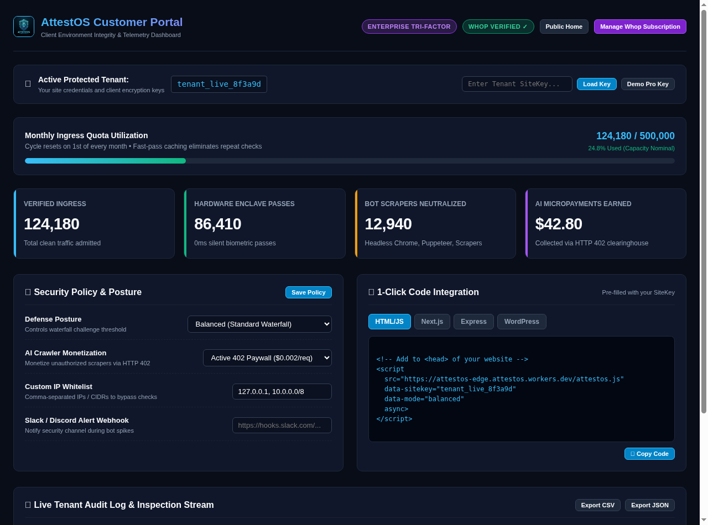

# AttestOS Paying Customer Security & Integration Guide
**Document Version:** 2.1.0-prod  
**Classification:** Customer Handbook  
**Live Access:** [`https://attestos-edge.attestos.workers.dev/portal`](https://attestos-edge.attestos.workers.dev/portal) (or `/customer`)

---

## 1. Welcome to AttestOS

As a paying customer of AttestOS (IntegrityRuntime Pro, Hardware Gateway Pro, AgentPass Pro, or the Enterprise Tri-Factor Suite), you receive dedicated access to the **Customer Security Portal**.

From this portal, you can monitor protected traffic in real time, customize defense postures, monetize unauthorized AI bots, generate 1-click SDK snippets tailored to your site key, and export audit compliance logs.



---

## 2. Accessing Your Portal

1. Visit [`https://attestos-edge.attestos.workers.dev/portal`](https://attestos-edge.attestos.workers.dev/portal).
2. Enter your unique **Tenant SiteKey** (e.g., `tenant_live_8f3a9d`) provided upon Whop checkout, or click **Demo Pro Key** to test the complete enterprise feature set instantly.
3. Your session is saved securely in `localStorage` for seamless re-entry.

---

## 3. Monitoring Your Monthly Ingress Quota

The **Monthly Ingress Quota Gauge** displays your current billing cycle consumption:

* **Fast-Pass Efficiency:** Because AttestOS issues a cryptographic 24-hour attested session cookie (`attestos_session`), repeat visits consume **zero verification quota**, allowing your monthly allowance to stretch up to 10x further than legacy captcha providers.
* **Auto-Reset:** Quota resets on the 1st of every calendar month.

---

## 4. Customer-in-the-Loop Security Policies

AttestOS puts you in complete control of how aggressively your site protects itself:

### A. Defense Posture Slider
* **Stealth Mode (Frictionless):** Disables visual and heavy mathematical friction entirely. Admits legitimate humans via silent hardware Secure Enclaves and light background WebCrypto checks (~10ms).
* **Balanced Mode (Recommended):** The optimal balance of security and speed. Evaluates search crawlers ➔ validates hardware passkeys ➔ runs standard Ghost-PoW (~80ms) on suspect traffic.
* **Fortress Mode (Strict Security):** Engages full Anti-CDP inspection, WebGL software GPU unmasking, and high-difficulty PoW (nibbles 6–8) on any unverified client.

### B. AI Crawler Monetization (HTTP 402 Paywall)
* **Active 402 Paywall ($0.002/req):** Intercepts automated scrapers (ByteSpider, CCBot, Diffbot) and requires programmatic payment settlement. Revenue accumulates directly in your dashboard ledger.
* **Block Scrapers Completely:** Returns immediate HTTP 403 Forbidden to unauthorized scrapers.
* **Permit Free Markdown:** Serves lightweight, clean markdown without paywalls.

### C. Custom IP Whitelists & Blacklists
Add trusted IPs or CIDR blocks (e.g., internal CI/CD servers, monitoring tools) to bypass pipeline checks completely.

### D. Webhook Alerting (Slack / Discord)
Paste your incoming webhook URL (e.g. `https://hooks.slack.com/services/...`). AttestOS will automatically ping your security team if bot attack velocity spikes above 100 requests/minute.

---

## 5. 1-Click Code Integration Snippets

The portal dynamically injects your specific `siteKey` into ready-to-copy code snippets across all major frameworks:

### Vanilla HTML / JavaScript
Add this single line into the `<head>` of your website:
```html
<script 
  src="https://attestos-edge.attestos.workers.dev/attestos.js" 
  data-sitekey="YOUR_SITE_KEY" 
  data-mode="balanced" 
  async>
</script>
```

### Next.js (App Router)
Include in `app/layout.jsx` or `app/layout.tsx`:
```jsx
import Script from 'next/script';

export default function RootLayout({ children }) {
  return (
    <html lang="en">
      <head>
        <Script 
          src="https://attestos-edge.attestos.workers.dev/attestos.js" 
          data-sitekey="YOUR_SITE_KEY" 
          strategy="afterInteractive" 
        />
      </head>
      <body>{children}</body>
    </html>
  );
}
```

### Node.js / Express Middleware
Protect your API endpoints and server routes:
```javascript
const { attestosMiddleware } = require('@attestos/node');

app.use(attestosMiddleware({
  siteKey: 'YOUR_SITE_KEY',
  edgeEndpoint: 'https://attestos-edge.attestos.workers.dev'
}));
```

### WordPress / WooCommerce
Define the configuration constants in `wp-config.php`:
```php
define('ATTESTOS_SITE_KEY', 'YOUR_SITE_KEY');
define('ATTESTOS_EDGE_URL', 'https://attestos-edge.attestos.workers.dev');
```

---

## 6. Live Audit Log & Compliance Export

Inspect all recent verification events processed for your domain in real time:
* **Columns:** Timestamp, Client IP, Device/Browser, Protection Layer (Pivot A, B, or C), Client Integrity Score (0–100), Status, and Execution Latency (<0.05ms).
* **Export CSV:** Downloads a formatted spreadsheet for security reviews.
* **Export JSON:** Generates machine-readable records for SIEM ingestion (Splunk, Datadog, AWS CloudWatch).
